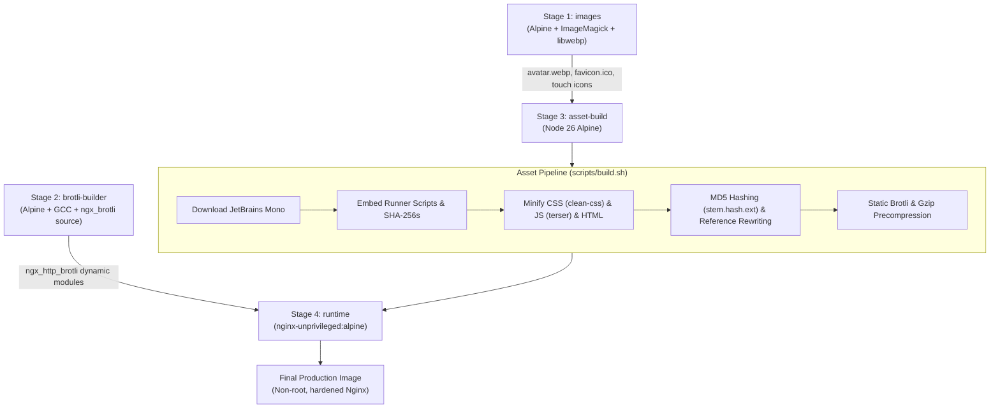

# vin.moe

[](https://vin.moe/)
[](https://nginx.org/)
[](https://github.com/google/ngx_brotli)
[](https://vin.moe/colophon)
[](https://vin.moe/)

The source code and static site container for [**vin.moe**](https://vin.moe), the personal website of Finlay.

Zero frameworks, zero external dependencies, content-hashed, precompressed with Brotli, and served from a single-node Talos Linux Kubernetes cluster behind a stateless RAM-only WireGuard relay.

---

## Highlights

- **Private by Construction:** Zero third-party scripts, external CDNs, fonts, or tracking beacons. Everything—including JetBrains Mono fonts and images—is bundled and served directly from the container.
- **Ultra-Lightweight & Fast:** Zero client-side frameworks (no React, Vue, or frontend bloat). Minimal semantic HTML, scoped CSS using native `light-dark()` color schemes, and vanilla JavaScript.
- **Precompressed & Content-Hashed:** Build pipeline minifies assets, generates 8-character MD5 content hashes (`stem.[hash].ext`), rewrites all internal asset references, and precompresses with Brotli (`.br`) and Gzip (`.gz`) for aggressive immutable caching.
- **Hardened Nginx Deployment:** Powered by `nginx-unprivileged:alpine` with Google's `ngx_brotli` compiled dynamically from source, strict CSP headers, and non-root execution.
- **Edge Logic with NJS:** Invite verification and edge handling handled via NGINX JavaScript (`njs`).

---

## Site Pages & Features

| Section | Route | Description |
| :--- | :--- | :--- |
| **About** | `/` | Introduction, homelab overview, PGP fingerprint (`43B0 BED0 F544 6DF5...`), and Fediverse links. |
| **Blog** | `/#blog`, `/blog/` | Technical essays on infrastructure, systems programming, and self-hosting. |
| **Work** | `/work` | Professional experience covering GCP observability, distributed systems, and DevOps engineering. |
| **Chat** | `/#chat`, `/chat/` | Landing page and install instructions for [`chat`](https://github.com/chat-labs/chat) (P2P post-quantum encrypted terminal chat over BitTorrent DHT / Nostr / Tor). Automatically embeds verified installer scripts and published SHA-256 digests. |
| **Colophon** | `/colophon` | Full engineering breakdown of the hosting stack: Proxmox VE, Talos Linux, Cilium eBPF, the Swiss RAM-only WireGuard relay, and Terraform pipelines. |
| **Invite** | `/invite/` | Secure invite code verification powered by NGINX JavaScript (`njs/invite.js`). |

---

## Multi-Stage Container Build

The container image is built in four distinct stages defined in `site-image/Dockerfile`:



1. **`images`:** Generates optimized WebP avatars (`avatar.webp`) and multi-resolution `favicon.ico` / `apple-touch-icon.png` using ImageMagick and `cwebp`.
2. **`brotli-builder`:** Clones `google/ngx_brotli` and compiles dynamic Nginx modules (`ngx_http_brotli_filter_module.so`, `ngx_http_brotli_static_module.so`) against the exact Nginx version.
3. **`asset-build`:** Uses Node.js tooling (`clean-css-cli`, `terser`, `html-minifier-terser`), fetches local fonts, embeds install scripts, hashes filenames, and creates `.br` and `.gz` precompressed artifacts.
4. **`runtime`:** Final minimal unprivileged Alpine image running as user `nginx` (UID 101) with custom `nginx.conf`, hardened headers, dynamic modules, and NJS scripts.

---

## Security & HTTP Headers

Served with strict security headers:

- **Content-Security-Policy (CSP):** `default-src 'self'; style-src 'self' 'unsafe-inline'; img-src 'self' data:; connect-src 'self' ...; frame-ancestors 'none';`
- **HTTP Strict Transport Security (HSTS):** `max-age=63072000; includeSubDomains; preload`
- **Cross-Origin Protections:** `X-Content-Type-Options: nosniff`, `X-Frame-Options: DENY`, `Referrer-Policy: strict-origin-when-cross-origin`
- **Permissions-Policy:** Completely disables camera, microphone, geolocation, interest-cohort, and payment APIs.
- **Server Privacy:** `server_tokens off;` suppresses version details; no visitor IP addresses are logged (visitor IPs are masked by the upstream WireGuard relay).

---

## Directory Structure

```
site-image/
├── Dockerfile              # Multi-stage optimized container build
├── conf/
│   ├── nginx.conf          # HTTP server configuration, headers, & routing
│   ├── nginx-main.conf     # Main Nginx process config (loads brotli modules)
│   ├── blog-proxy.inc      # Upstream blog proxy directives
│   └── invite.js           # NGINX JavaScript (njs) invite authentication logic
├── html/
│   ├── index.html          # Main landing page (About, Blog, Work, Chat tabs)
│   ├── blog/               # Blog archive and index
│   ├── chat/               # Chat landing page and runner download endpoints
│   ├── colophon/           # Architectural deep dive ("how this site runs")
│   ├── invite/             # Invite code verification page
│   ├── work/               # Work history and project portfolio
│   ├── css/style.css       # Core stylesheets (light-dark theme variables)
│   └── js/                 # Theme initialization and navigation scripts
├── posts/                  # Markdown source for blog posts
├── scripts/
│   ├── build.sh            # Minification, content-hashing, & compression script
│   ├── embed-runner.sh     # Injects chat runners and SHA-256 hashes into chat/index.html
│   └── fetch-fonts.sh      # Downloads JetBrains Mono webfonts locally
└── src/images/             # Source avatars and favicon artwork
```

---

## Local Development

### Prerequisites

- [Docker](https://www.docker.com/) or [Podman](https://podman.io/)

### Build the Image

```sh
cd site-image
docker build -t vin.moe .
```

### Run the Container

```sh
docker run --rm -p 8080:8080 --name vin-moe vin.moe
```

Open [http://localhost:8080](http://localhost:8080) in your browser.

### Verify Headers & Compression

```sh
# Verify HTTP response headers
curl -I http://localhost:8080/

# Test Brotli static compression
curl -H "Accept-Encoding: br" -I http://localhost:8080/
```

---

## Deployment

The image is built and tested automatically in GitLab CI. Upon merge to `prd`, BuildKit builds and pushes the immutable digest to `artifacts.vinnel.cloud`, records the digest in `site-images.json`, and triggers a rolling update against the Kubernetes cluster.

---

## Colophon

To learn how this site is served from a homelab server behind a RAM-only Swiss relay, visit [vin.moe/colophon](https://vin.moe/colophon).
